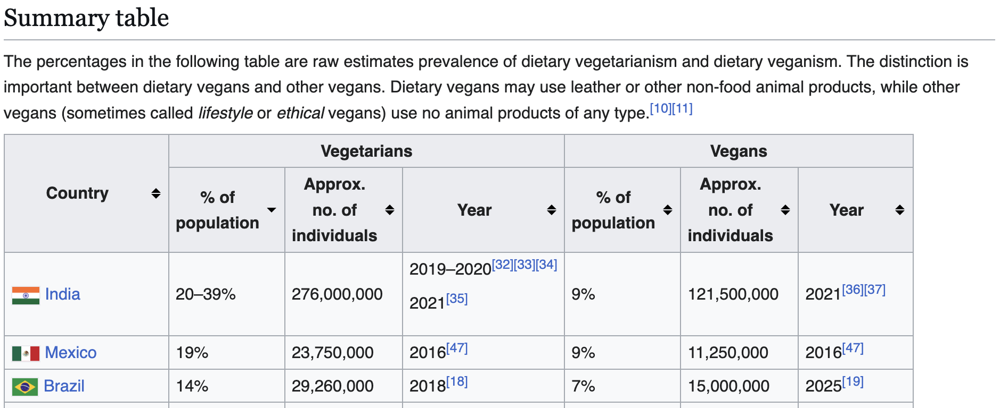
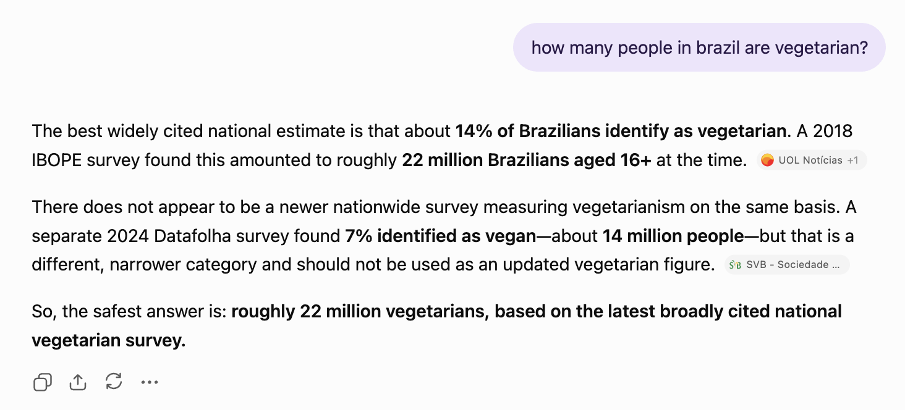

## Someone is wrong on the internet

I often compete with my family for the highest score in various daily geography quiz games. I recently took second place to my brother in one game by giving what was apparently a massive underestimate for how many people in Brazil are vegetarian. The game claimed that Brazil is the third-most vegetarian country in the world. While I was admittedly motivated by the sting of losing, this was very surprising to me.

](2026-08-27-someone-is-wrong-on-the-internet.png){width="50%" fig-align="center" fig-alt="xkcd comic 386: a person at a keyboard answers someone off-panel who has asked if they are coming to bed, saying they cannot because someone is wrong on the internet."}

Fully expecting to find that the game had made an error, I was even more surprised to see Wikipedia's [Vegetarianism by country](https://en.wikipedia.org/w/index.php?title=Vegetarianism_by_country&oldid=1363164359) table claim the "prevalence of dietary vegetarianism" in Brazil is 14%, or 29.3 million people.

{fig-align="center" fig-alt="Wikipedia's Vegetarianism by country summary table. The Brazil row lists 14% of the population, about 29,260,000 people, for 2018, above Mexico at 19% and below India at 20 to 39%."}

Other sources affirmed some version of this claim: the New York Times [in December 2020](https://archive.ph/kEDc3) asserted that self-declared vegetarianism in Brazil had, remarkably, nearly doubled in just six years before reaching 14% of Brazilians in 2018. [A 2020 report](https://apps.fas.usda.gov/newgainapi/api/Report/DownloadReportByFileName?fileName=Brazil%27s%20Plant-Based%20Food%20Trends_Sao%20Paulo%20ATO_Brazil_05-16-2020) from the USDA's Foreign Agricultural Service similarly stated that "30 million people in Brazil consider themselves vegetarians." 

A [peer-reviewed paper](https://www.sciencedirect.com/science/article/abs/pii/S0743016719305637) in the Journal of Rural Studies and a 2022 Brazilian Senate hearing [transcript](https://archive.ph/FoM2j) both go further, with the latter claiming "almost 30 million Brazilians...do not use meat in their diet."

This claimed rate stands out in part because it is much higher than the corresponding rate for vegetarianism in the US.[^1] In 2023, Gallup had [4%](https://archive.ph/YMXR4) of Americans as vegetarian-identifying. With respect to dietary vegetarianism, an older [study](https://doi.org/10.1093/ajcn/78.3.626S) found that more than half of vegetarian-identifying Americans still reported eating meat on at least one recall day; only 0.9% of the full sample both identified as vegetarian and reported eating no meat.

These large differences between estimates of vegetarian identity and actual dietary practice point towards a pedantic-sounding but important question central to understanding what's going on here: what is a vegetarian? In different contexts, "vegetarian" is used to describe many different points on a broad spectrum of both behaviors and beliefs.

## Partial vegetarians?

As it turns out, the prominent versions of this particular claim all come from the same place. In 2018, IBOPE Inteligência, a well-regarded Brazilian polling and market-research company,[^2] surveyed 2,002 Brazilians aged 16 and older "to understand perceptions of the population about vegetarianism." The [survey](https://svb.org.br/wp-content/uploads/2026/07/JOB_0416_VEGETARIANISMO-Relatorio-de-tabelas.pdf) was commissioned by Sociedade Vegetariana Brasileira (SVB), a national vegetarian advocacy organization, but I didn't see any obvious signs that the work was compromised by this affiliation. It at least appears to have been conducted using reasonable methodological choices—the sample is said to have been derived from the Brazilian census and a three-stage cluster design; interviews were conducted in person. I used to work on the sampling frame for a household survey at the US Census Bureau and, while I wouldn't characterize this effort as gold standard (they used some kind of quota selection at the final stage), nothing jumped off the page to me as obviously disqualifying.

However, the survey focused on attitudes related to vegetarianism, not actual dietary practices. The questionnaire included a section where respondents were presented with a number of statements, including "I am vegetarian," and asked about the extent to which they agreed or disagreed.

| Response to "I am vegetarian" | Share  |
| :---------------------------- | :----- |
| Totally disagree              | 66%    |
| Partly disagree               | 15%    |
| Neither agree nor disagree    | 5%     |
| **Partly agree**              | **6%** |
| **Totally agree**             | **8%** |

Adding the totals from "Partly agree" and "Totally agree" (see [page 17](https://svb.org.br/wp-content/uploads/2026/07/JOB_0416_VEGETARIANISMO-Relatorio-de-tabelas.pdf)) yields 14%, which matches the figure cited widely today. 

This immediately presents at least one eyebrow-raising conclusion. Almost half of Brazil's purported vegetarian population only "partly" agreed that they are vegetarian. Given the binary nature of both the formal and popular understanding of the term—"[a person who does not eat meat](https://www.merriam-webster.com/dictionary/vegetarian)"—I suspect most people would find a "partial" vegetarian better characterized as an "omnivore" who perhaps only eats certain kinds of meat, or who eats meat less often than average. However, such a person might still be of interest if you are studying the market for plant-based foods, so using a gradient isn't a completely unreasonable choice in this setting, provided the estimate is reported with sufficient context.[^3]

This makes the survey itself look less like a bad attempt to estimate vegetarian prevalence than a survey answering a different question. However, the way it has been referenced over time is quite problematic.

## Error cascade

After the survey was completed, topline estimates began changing almost as soon as they were first reported. [Contemporary reporting](https://archive.ph/t8WzK) translated 14% of Brazilians over 16 to about 22 million people, but [other sources](https://archive.ph/51YlH) commonly applied 14% to the country's entire population, producing roughly 30 million.

In 2020, the New York Times reported that 30 million people self-identified as vegetarian or vegan, even though these respondents were never asked about vegan identification. In the same article, this share is also said to have "nearly doubled" by comparing it to 2012 results from a separate [study](https://archive.ph/Mmet0) whose respondents were 18 or older, had made a purchase in the previous 30 days, and were interviewed primarily in metropolitan regions (a population not comparable to IBOPE's in 2018). 

The same kinds of errors are present in many other online publications, including peer-reviewed academic papers. Versions of the statistic are prevalent enough that GPT 5.6 Sol-High, with web search enabled, regurgitates without qualification the version that conflates "Partly agree" with "identify as vegetarian."

{.img-border width="80%" fig-align="center" fig-alt="A chatbot answering how many people in Brazil are vegetarian. It reports that about 14% of Brazilians identify as vegetarian, that a 2018 IBOPE survey put this at roughly 22 million Brazilians aged 16 and over, and concludes with that 22 million figure."}

## So how many are there?

I haven't seen a nationally representative survey from Brazil that defines vegetarianism behaviorally. However, in May and June 2018, Faunalytics, an animal-advocacy research organization, surveyed 1,027 Brazilians as part of a [cross-country study](https://archive.ph/Vf8RM). Instead of asking whether respondents identified as vegetarian, it asked which types of food they had eaten during the previous year. People who reported eating none of the listed meat categories were classified as vegetarian or vegan. In Brazil, the study estimated that share at 1%, the same as in Russia and China. The US had 4% and India had 31%. This wasn't a probability survey, but the instrument's framing in terms of recalled food consumption is much better suited to characterizing the prevalence of dietary vegetarianism, and provides a useful comparison between the rate in Brazil and in other countries.

These results are also more consistent with other data points. Brazil's 2017–18 Household Budget Survey asked 46,164 respondents from a representative sample about their diet during two non-consecutive 24-hour periods; [a later analysis found](https://doi.org/10.3390/ijerph21121625) that 98% consumed some meat on the reported days, meaning 2% consumed none.

Contemporary research based on narrower subsets of the country also land in the same neighborhood. In ELSA-Brasil, [only 0.6%](https://doi.org/10.1016/j.jad.2022.09.059) of mostly middle-aged white collar employees and retirees reported no meat consumption. A larger share—[6.4%](https://archive.ph/IEyMj)[^4]—of first-year students at a southern Brazilian university self-classified as vegetarian.

This is all to say that we don't know exactly, but if I had to bet—or, more realistically, make a guess as part of another online geography quiz game—I'd estimate the share of Brazilians who actually abstain from meat in the low single digits.

---

*Human-authored.*

[^1]:  I'd guess that if meat-abstainers were an order of magnitude more common in Brazil than in the US, this demographic fact would bleed into perceptions about the country's overall identity as it has for India, where Pew and other high-quality surveys find that around [four-tenths](https://archive.ph/wukZA) of the population identifies as vegetarian. If anything, characterizations of dietary attitudes and behavior seem more likely to characterize Brazil as a "[meaty](https://archive.ph/4iyM0)" country where barbecue is a "[way of life](https://archive.ph/LfGZg)." Per capita meat consumption in Brazil [ranks among the highest in the world](https://ourworldindata.org/grapher/per-capita-meat-consumption-by-type-kilograms-per-year?tab=table&country=~BRA).

[^2]:  Per [Wikipedia](https://en.wikipedia.org/w/index.php?title=IBOPE&oldid=1364939082), "the name IBOPE is listed in the Brazilian dictionary as a synonym of audience ratings research."

[^3]:  This isn't trivial though; there are real issues with suggesting this question measures "vegetarianism" for the 8% who "totally agree." Regardless of how the two groups are combined, I suspect meat-eating is a case where [acquiescence bias](https://archive.ph/sQolb) is relevant in interpreting these results (especially with in-person interviewers). I'd also pause at transforming any agreement gradient like this one into a binary yes-no estimate, like many sources did with "partly or totally = is vegetarian."

[^4]:  Nominally higher but consistent with [research](https://archive.ph/iNr92) in other settings that finds young people report higher rates of vegetarianism.

